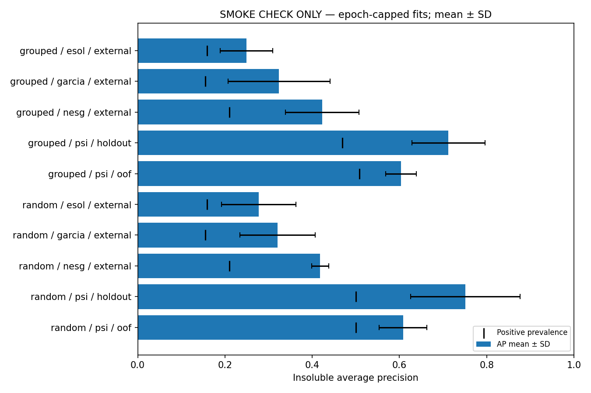

# Training report — 20261108

SMOKE VALIDATION ONLY: epoch-capped results are not scientific performance estimates.

Training rows: 128; insoluble: 64; groups: 128. Seeds: [11, 29, 47, 71, 101].

See protocol JSON for features/architecture and fits JSON for parameter counts, epoch selection and split membership. OOF predictions come from three training-only folds; five holdouts differ. Random splits allow homologous groups to cross boundaries; grouped splits do not. Repeated holdout SD is descriptive, not an independent-replicate confidence interval. External panels stay fixed, evaluated by five separately trained models.

Thresholds use training OOF scores. OOF threshold metrics are apparent after threshold selection; holdout metrics are the assessment. Sigmoid scores are uncalibrated. A target OOF recall does not guarantee future insolubility rejection or an accepted-set contamination rate.

